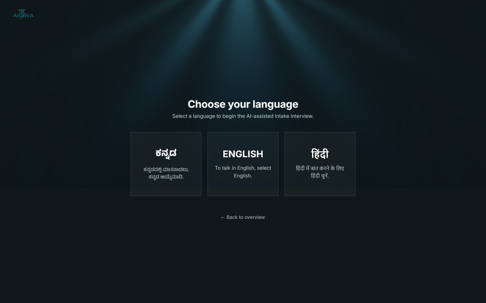
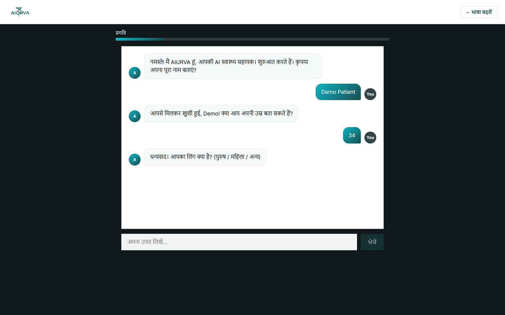
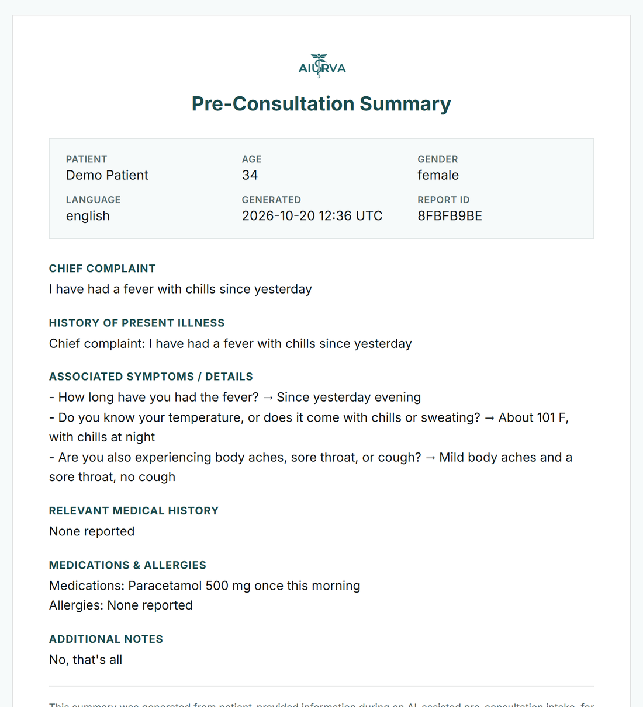
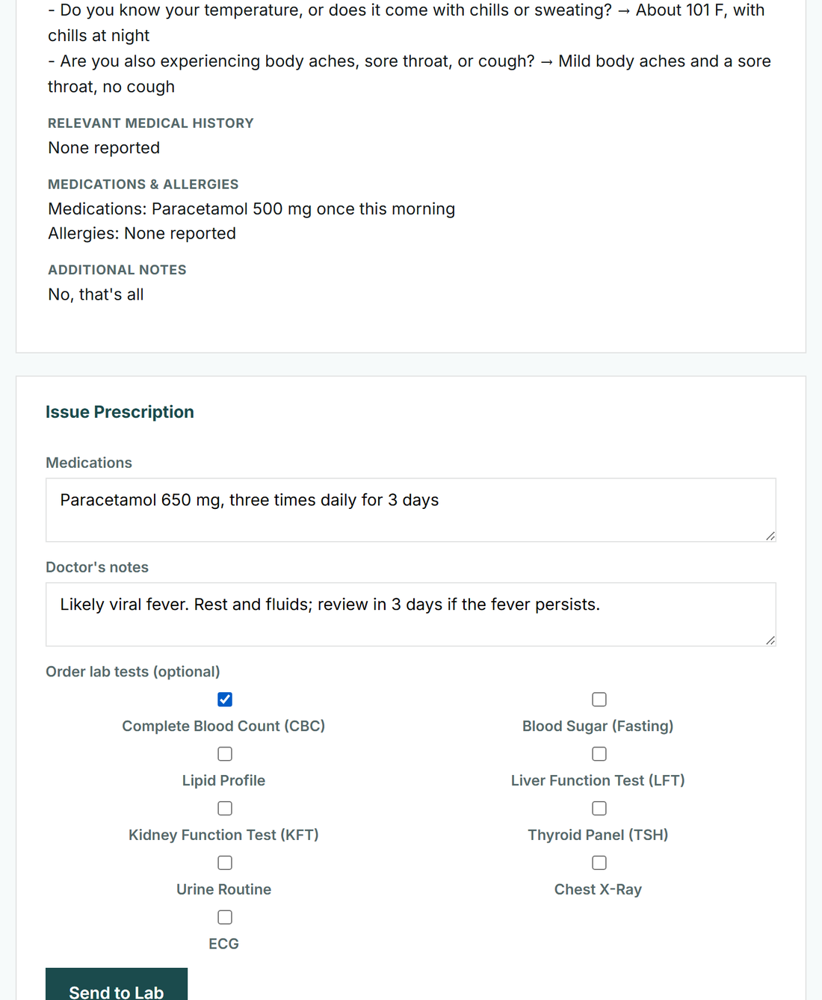
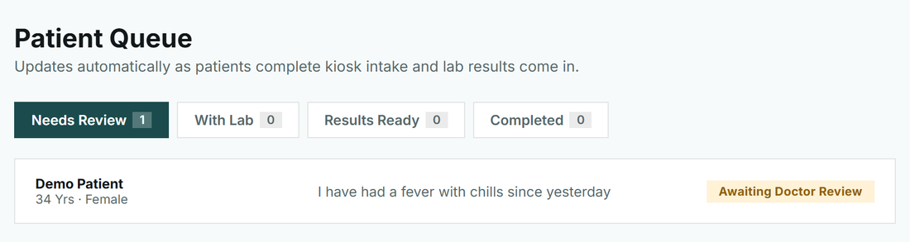
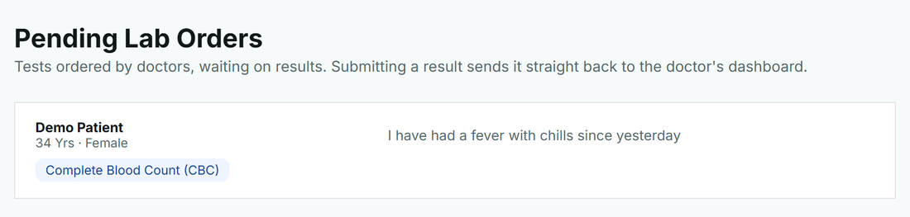
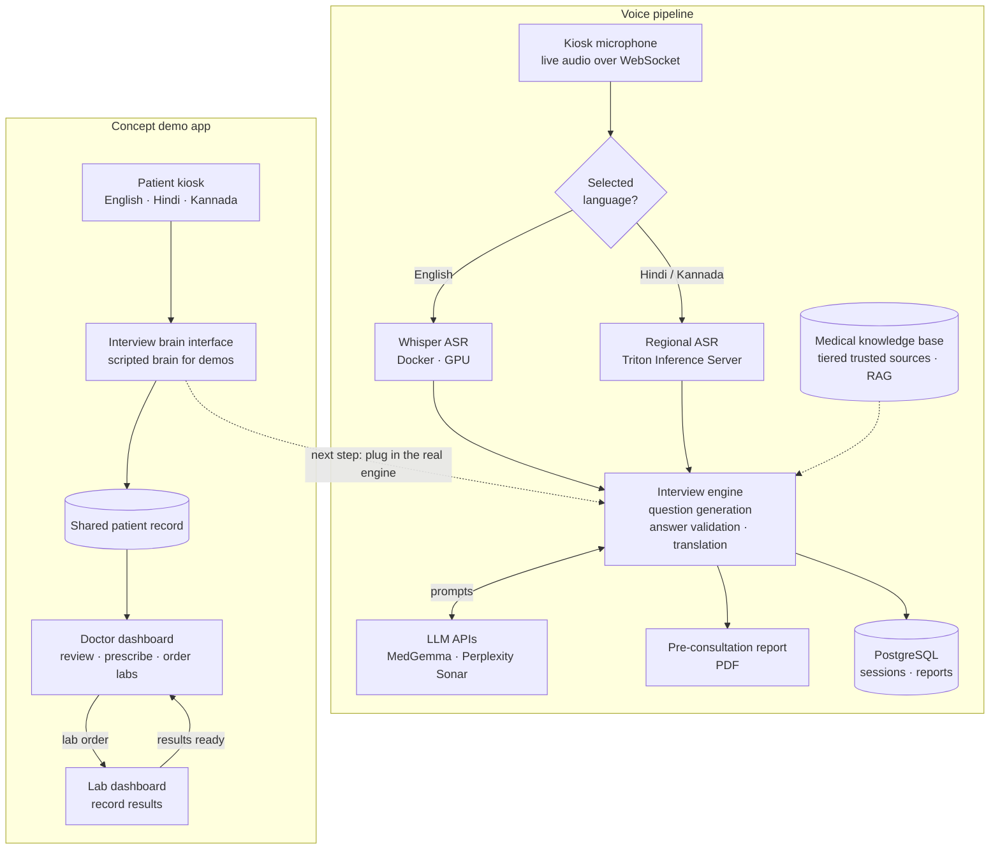

# AIURVA: Multilingual AI Health Intake (Concept)

A concept for a voice-first health kiosk that interviews patients in English, Hindi or Kannada before they see a doctor, writes a pre-consultation summary, and carries the patient through doctor and lab review on one shared record.

> **Note:** The source code is private. This repository documents the concept, architecture and design decisions. I'm happy to walk through the implementation in an interview.

> **Status: concept and working prototype.** The demo app shown below runs end to end with a scripted interview, so it can be demonstrated without GPUs or API keys. The full voice pipeline (language-routed speech recognition and an LLM-driven interview) is built as a separate service, and connecting the two is the next step.

| | |
|---|---|
|  |  |
| *The patient chooses English, Hindi or Kannada* | *The guided interview, here in Hindi* |
|  |  |
| *A pre-consultation summary for the doctor* | *The doctor prescribes and orders lab tests* |
|  |  |
| *The doctor's queue, grouped by stage* | *Ordered tests appear for the lab technician* |

*All screenshots use a fictional demo patient.*

---

## Overview

In India, primary-care consultations are short and doctors often see patients who speak a different first language. A lot of each visit goes on collecting basic history that a patient could give in advance.

AIURVA explores a kiosk that does that intake first. The patient picks a language and answers a short, adaptive interview by voice or text. The system produces a structured summary (chief complaint, history of the present illness, medications, allergies) so the doctor starts the consultation already informed. The same record then moves from the doctor to the lab and back, so nothing is re-typed between roles.

## Key Features

- **Three languages end to end:** English, Hindi and Kannada, from language selection through the interview and the summary.
- **Language-routed speech recognition:** English audio goes to a Whisper model and Hindi or Kannada audio goes to a separate regional model served with Triton, each running in its own Docker container.
- **Adaptive interview:** after the basic details, follow-up questions branch on the chief complaint (fever, headache, cough and cold, stomach issues and so on).
- **Answer validation:** each answer is checked before it's accepted, so a mis-heard or off-topic reply triggers a polite re-ask instead of polluting the record.
- **Pre-consultation summary:** a structured report for the doctor, viewable on screen and downloadable as a PDF.
- **Clinical workflow on one record:** the doctor reviews, prescribes and orders tests; the lab enters results; the record returns to the doctor as "results ready", with status tabs for each stage.

## Architecture

## How It Works

1. The patient chooses a language at the kiosk.
2. In the voice pipeline, live microphone audio streams to the server over a WebSocket and is routed to the speech model for that language.
3. The interview engine asks the next question, validates the answer, and translates between the patient's language and English so the model reasons in one language while the patient stays in theirs.
4. A knowledge pipeline gathers content from tiered, trusted medical sources and prepares it for retrieval, to ground the assistant's medical answers.
5. When the interview is complete, the engine writes the pre-consultation summary and saves the session.
6. In the clinical workflow, the doctor reviews the summary, prescribes and orders tests, the lab records results, and the record returns to the doctor to close the case.

## Results

| What the prototype covers | |
|---|---|
| Languages | 3 (English, Hindi, Kannada) |
| Speech-recognition backends, routed by language | 2 (Whisper, Triton-served regional model) |
| Guided interview | 11 steps, with complaint-specific follow-up questions |
| Roles sharing one patient record | 3 (patient kiosk, doctor, lab technician) |

This is a concept: it hasn't been evaluated on real patients, and there are no accuracy or latency benchmarks yet.

## Tech Stack

| Category | Tools |
|---|---|
| Speech recognition | Whisper (Docker, GPU), regional ASR on Triton Inference Server |
| Language models | MedGemma and Perplexity Sonar via API, hand-written multi-stage prompts |
| Retrieval | Tiered medical-source scraping, chunking, embeddings, ChromaDB / FAISS |
| Backend | FastAPI, WebSockets, SQLAlchemy, PostgreSQL |
| Reports | ReportLab PDF generation |
| Frontend | React, TypeScript, Vite; browser AudioWorklet for live microphone capture |
| Deployment | Docker containers for the speech models |

## Engineering Decisions

- **Route speech by language:** English goes to Whisper and Hindi or Kannada to a dedicated regional model, behind one routing layer, so each language uses a model suited to it and a new language is just another route.
- **Translate for reasoning, answer in the patient's language:** the model works in English, where it's strongest, while every question and summary stays in the language the patient chose.
- **Validate before you record:** speech recognition mis-hears and patients go off-topic, so every answer is checked before it's stored, and the interview re-asks politely instead.
- **A swappable interview brain:** the demo app talks to the interview logic through one small interface. A deterministic, scripted brain makes live demos reliable without GPUs or API keys, and the real LLM engine can be plugged in behind the same interface without touching the rest of the app.

## My Role

I designed and built AIURVA myself: the language-routed speech pipeline, the interview engine with answer validation and translation, the medical knowledge pipeline, the PDF reporting, and the concept demo app (React/TypeScript frontend, FastAPI backend and the three-role clinical workflow).

## Contact

**Zayed Makandar** | [zayedmakandar03@gmail.com](mailto:zayedmakandar03@gmail.com) | [LinkedIn](https://www.linkedin.com/in/zayed-makandar-642536422/) | [Portfolio](https://zayedmakandar.com)
